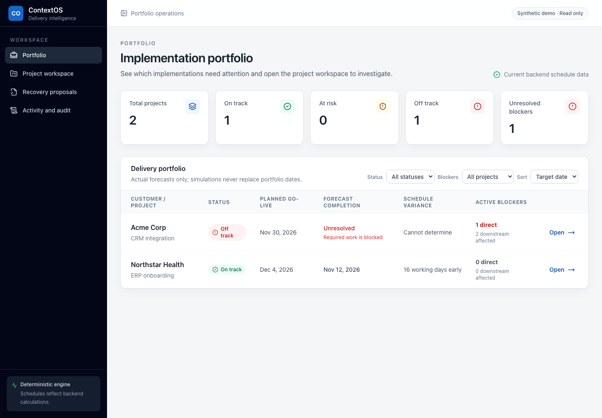
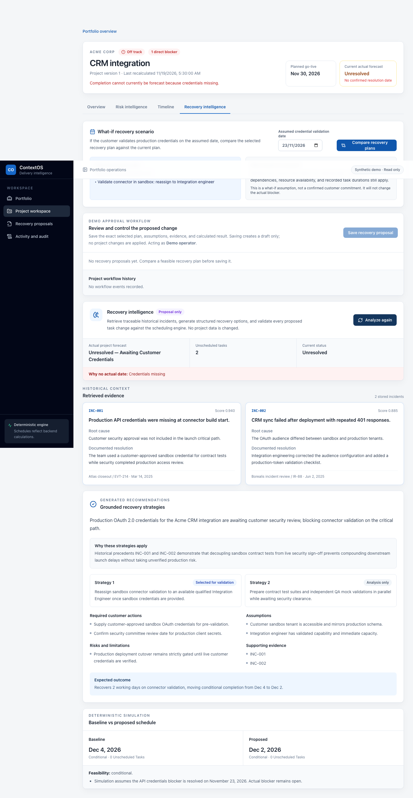
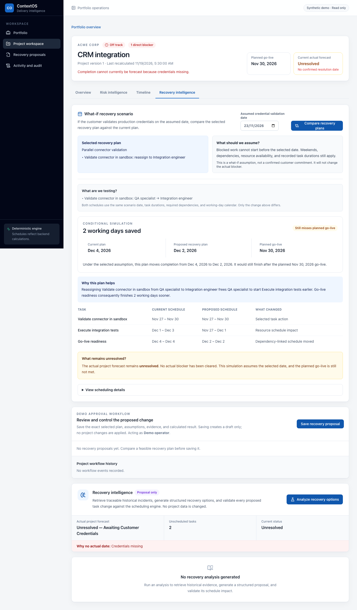

# ContextOS

ContextOS organizes the demo into four business workflows: a backend-derived implementation portfolio, a project workspace, a recovery proposal register, and immutable activity history. Within a project, users can understand confirmed risks, inspect the actual working-day timeline, define what-if assumptions, compare the exact selected recovery plan, save it for explicit approval, execute supported changes, and verify persisted results without treating simulated dates as actual forecasts.

ContextOS is an implementation-delivery intelligence prototype that turns project blockers, dependencies, resource constraints, and historical evidence into reviewable recovery scenarios. A deterministic scheduler—not the language model—owns every date and feasibility decision.

> **ContextOS is an independent prototype using synthetic data. It is not an official Rocketlane product.**

## The problem

Implementation teams often discover delivery risk only after a dependency, credential, approval, or specialist becomes critical. Recovery decisions are then scattered across status meetings and spreadsheets, with weak evidence and no controlled path from recommendation to execution.

ContextOS demonstrates a safer operating model:

`Detect → Retrieve → Reason → Simulate → Approve → Execute → Verify`


*Figure 1: Portfolio Operations & Risk Detection — Aggregates live delivery health across onboarding projects derived deterministically from backend schedule logic, surfacing blocked tasks, critical path variance, and delivery risks without relying on manual status updates.*


*Figure 2: Grounded Recovery Analysis & Simulation — Synthesizes pgvector-retrieved historical incident evidence with structured AI reasoning to generate actionable recovery strategies, customer prerequisites, and deterministic baseline vs. proposed forecast comparisons.*


*Figure 3: What-If Scenario Comparison & Governed Execution — Evaluates conditional recovery assumptions against the scheduling engine, calculates verified working days saved on the critical path, and routes feasible proposals through an explicit operator approval and audit workflow.*

## Product capabilities

- Portfolio and project risk views derived from backend schedule data.
- Working-day-aware scheduling with dependency, blocker, resource, and critical-path validation.
- PostgreSQL/pgvector retrieval over 12 traceable synthetic implementation incidents.
- OpenAI structured recovery proposals with evidence-ID validation and strict action schemas.
- Conditional scenarios that never convert hypothetical blocker dates into actual project state.
- Explicit human approval by a clearly labeled prototype `Demo operator`.
- Version-checked, idempotent, transactional execution of allowlisted task changes.
- Immutable backend-generated audit history and separate actual versus conditional forecasts.
- Synthetic demo reset with explicit confirmation and environment restrictions.

## Recovery scenario portfolio

The synthetic portfolio contains ten isolated project snapshots. The original five remain unchanged; five additional projects exercise resource absence, data-quality rework, mandatory authentication remediation, late scope expansion, and QA contention:

| Project | Scenario | Useful comparison |
|---|---|---|
| Vertex Financial | Critical banking API engineer unavailable | Wait vs qualified reassignment vs redistributed independent work |
| Meridian Logistics | 25% invalid migration records | Sequential cleanup vs parallel batches vs late validation capacity |
| Atlas Technologies | Critical SSO defect in UAT | Mandatory fix/retest vs qualified remediation reassignment |
| Horizon Commerce | Additional region requested | Combined launch vs phased commitment vs regional specialists |
| Summit Analytics | Shared QA bottleneck | Current allocation vs qualified data/security validation capacity |

To exercise a scenario, open the project’s **Recovery Intelligence** tab, select a strategy card, choose **Compare recovery plans**, inspect the calculated outcome, and save only a feasible executable strategy. Zero-improvement and regression results are intentional and are reported honestly. To load the five new historical evidence records into PostgreSQL, run `cd backend && uv run python -m app.seed_historical`; the seed uses stable incident IDs and updates idempotently without deleting existing records.

## Architecture

```text
React + TypeScript
        │ typed REST
        ▼
FastAPI application services
   ├── deterministic scheduler ── project state overlay
   ├── retrieval service ──────── OpenAI embeddings + pgvector
   ├── recovery planner ───────── OpenAI structured Responses
   └── approval/execution ─────── PostgreSQL transaction + audit
```

The model may propose only schema-constrained task changes. Backend services validate task IDs, evidence IDs, resource qualifications, dependencies, proposal status, project version, and idempotency before execution. OpenAI never receives database credentials and cannot issue database operations.

See [architecture](docs/ARCHITECTURE.md), [API notes](docs/API.md), and [implementation plan](docs/IMPLEMENTATION_PLAN.md).

## Acme demo workflow

The featured synthetic project is a fictional Salesforce OAuth integration for Acme Corp.

1. Detect the unresolved OAuth credential blocker.
2. Retrieve relevant historical incidents.
3. Generate a structured OpenAI proposal.
4. Assume credentials may be validated on November 23, 2026.
5. Compare the deterministic baseline and recovery schedule.
6. Review and explicitly approve the exact change.
7. Execute the qualified-resource reassignment transactionally.
8. Verify the version increment, assignment, remaining blocker, and audit trail.

The reproducible scenario moves sandbox validation to an existing qualified integration engineer. The scheduler calculates a conditional change from December 4 to December 2—two working days—because independent QA and sandbox work can run in parallel. The actual forecast remains unresolved until credentials are truly validated.

The complete presentation is in the [90-second walkthrough](docs/DEMO_WALKTHROUGH.md).

## AI evaluation

The checked-in suite contains 20 explicit synthetic cases across missing credentials, authentication failures, mapping errors, resource conflicts, customer approvals, test bottlenecks, invalid dependencies, and infeasible plans.

| Metric | Deterministic regression result |
|---|---:|
| Retrieval Recall@5 | 0.950 |
| Retrieval MRR | 0.892 |
| Evidence citation validity | 0.950 |
| Structured output validity | 0.850 |
| Unsupported action rate | 0.100 |
| Schedule feasibility rate | 0.750 |
| Approval safety | 1.000 |
| Execution correctness | 1.000 |

These are evaluation-suite measurements, not production-quality claims. Invalid cases are intentionally included, so structured-output validity and feasibility are expected to be below 1.0. A selected live subset used OpenAI embeddings with PostgreSQL/pgvector and retrieved the expected credential incident in both cases. One live structured Responses case also passed schema, citation, action-allowlist, and scheduler validation; both actual and proposed forecasts correctly remained unresolved without a hypothetical unblock date. Raw results are stored in [EVALUATION_RESULTS.json](docs/EVALUATION_RESULTS.json).

Run the deterministic suite:

```bash
cd backend
PROJECT_STORE=memory HISTORICAL_STORE=memory uv run python -m app.evaluation
```

Run the bounded live subset:

```bash
uv run python -m app.evaluation --live --live-limit 2
```

## Safety mechanisms

- Backend-only OpenAI keys; no secret is compiled into the frontend.
- Pydantic structured outputs and a strict action allowlist.
- No duration shortening or required-dependency removal.
- Qualified-resource and dependency-cycle validation.
- Explicit approval, project-version checks, row locking, and idempotency keys.
- Actual blockers are preserved during simulation and execution.
- Bounded OpenAI timeouts, retries, batch sizes, usage tracking, and request rate limits.
- Environment-configured CORS with credentials disabled.
- Public production mode defaults to read-only unless writes are explicitly enabled.
- Safe API errors and logs that omit prompts, secrets, and customer credentials.

The built-in rate limiter and demo operator are prototype controls. A multi-instance deployment needs real identity, per-user isolation, and a distributed edge limiter.

## Tech stack

- React 18, TypeScript, Vite, Tailwind CSS
- FastAPI, Pydantic, SQLAlchemy, Alembic
- PostgreSQL 16 and pgvector
- OpenAI Responses API and Embeddings API
- Pytest, Vitest, Testing Library, Playwright
- Docker and Nginx deployment artifacts

## Local setup

Requirements: Docker, Python 3.12, Node.js 22, and `uv`.

```bash
# Clone the repository
git clone https://github.com/Subramanian13/ContextOS.git
cd Rocketlane

# Configure environment variables
cp .env.example .env
# Open .env and add your OPENAI_API_KEY (and optional Salesforce credentials)

# Start PostgreSQL 16 with pgvector
docker compose up -d --wait db

# Setup and run backend
cd backend
uv sync --extra dev
uv run alembic upgrade head
uv run python -m app.seed_historical
uv run uvicorn app.main:app --reload --no-access-log
```

In a second terminal:

```bash
cd frontend
npm ci
npm run dev
```

Open `http://localhost:5173`; API documentation is at `http://localhost:8000/docs`.

## Verification

```bash
cd backend
PROJECT_STORE=memory HISTORICAL_STORE=memory uv run pytest

cd ../frontend
npm test
npm run build
npm run test:e2e
```

Migration and smoke checks:

```bash
cd backend
uv run alembic current
curl -fsS http://127.0.0.1:8000/health/live
curl -fsS http://127.0.0.1:8000/health/ready
curl -fsS http://127.0.0.1:8000/api/v1/projects
```

## Deployment

Provider-neutral backend/frontend Dockerfiles and a production Compose reference are included. The recommended public portfolio configuration is read-only:

```text
CONTEXTOS_ENV=production
DEMO_MODE=true
DEMO_WRITE_ENABLED=false
```

See [deployment preparation](docs/DEPLOYMENT.md) for migrations, pgvector, health checks, secrets, operational requirements, and hosting choices.

## Known limitations

- All customers, incidents, credentials, and schedules are synthetic.
- This is not a multi-tenant system and does not implement enterprise identity or authorization.
- The optional connector can read a configured Developer Edition org, but it does not authenticate to an Acme/customer production org or validate customer credentials.
- Base projects are seed-backed; approved changes use a PostgreSQL versioned overlay.
- Customer follow-ups are recorded but not sent externally.
- The in-process limiter is not distributed across API replicas.
- Audit immutability is enforced by application services, not a database trigger or append-only role.
- Evaluation coverage is deliberately small and does not establish production model quality.
- Browser tests use deterministic API fixtures; backend transactional workflow tests separately cover persistence and rollback.
